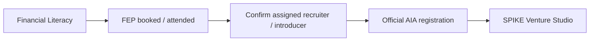

# Official AIA registration (Command Center)

Synthetic Command Center milestone. Official AIA iRecruit remains the system of record. No schema migration.

Entities stay distinct: `Candidate → User Account → Program Enrollment → Program Role`. AIA registration is an append-only **candidate timeline** event. It does not create a user account, program enrollment, or program role, and it does not change Versa/SPIKE entitlements or paid L2.

## Journey

If no recruiter is assigned (early registrant), attribution falls back to the configured default recruiter and is recorded as `attributionSource = default_recruiter`. Staff can reassign later.

AIA advisor path only (`program_interest = ra_spike`). Interns and free learners never enter this gate.

States (derived from `candidate_events`, not new `candidates.stage` values):

1. `aia.attribution.confirmed` — staff confirms recruiter/introducer + referral source
2. `aia_registration_pending` — candidate self-report or staff recording that report
3. `aia_registration_submitted` — human staff action
4. `aia_registration_verified` — human staff action (who verified + when)

Leader task after attribution: **Help candidate register via your AIA account / iRecruit**.

Handoff uses the assigned recruiter’s attributed registration URL from env/config, or the default recruiter URL (`AIA_DEFAULT_RECRUITER_REGISTRATION_URL`). If neither is configured, the handoff is that leader task only — no link.

Attributed URL shape (do not commit real `reference` values or agent codes):

`https://www.aia.com.ph/en/financialadvisor/join-us-now?reference=<base64 JSON {code, name}>`

A bare `join-us-now` URL (no `reference`) drops recruiter credit and is rejected. Optional `scroll=1` may be appended to jump to the form (`appendAiaFormScroll`). The append is skipped unless the URL still validates and `reference` is unchanged. Applicant field prefill is not supported.

## AIA join-us-now evidence (read-only)

SPIKEDEV verified the live page with headless Chrome and a synthetic `reference`. The page reads `reference`, `cmpid`, `scroll`, and `clickid`. A valid `reference` greets: `Hi! I'm <recruiter name>, your assigned Life Planner`.

Form fields:

1. Honorifics (Mr/Miss/Mrs)
2. First Name
3. Last Name
4. Date of Birth
5. Email Address
6. Mobile Number (format e.g. 639123456789)
7. I'm Applying To Be (Full Time / Part Time)
8. Preferred Location (City)
9. Consent checkbox — done by the candidate on AIA's form
10. reCAPTCHA — done by the candidate on AIA's form

Copy-assist covers fields 1–8 only (`lib/mvp01/aia-assisted-fields.ts`; G1 mirrors that file byte-for-byte). Each field is either collected from consented candidate data or marked `ask the candidate on AIA's form`. Date of Birth is shown only if it already exists on the consented record; Command Center does not collect it.

Do not auto-mark signup, acceptance, licensing, or agent coding. Do not advance `irecruit_started` / `licensing` / `coded` from this flow. A Versa lead or paid flag never implies AIA registration. Never log or display the decoded agent code to candidates.

## Staff reference pages (do not send to recruits)

These public pages are **staff reference only**. Do not send them to recruits. They are not Command Center handoff URLs.

- https://www.aia.com.ph/en/financialadvisor/partner-with-the-best — staff reference; do not send to recruits
- https://www.aia.com.ph/en/financialadvisor/join-us-now — generic Join us; do not send to recruits (forbidden without a recruiter `reference`)

No AIA credentials fields, no scraping, no cloned AIA form, no invented deep links.

## Recruiter-assisted registration view

On the leader task **Help candidate register via your AIA account / iRecruit**, admins and the assigned leader can open a copy-assist view of consented candidate details in AIA form field order (`lib/mvp01/aia-assisted-fields.ts`, shared with G1 #19; G1 mirrors that file byte-for-byte). Per-field copy buttons are audit-logged as read events (`aia.assisted.opened` / `aia.assisted.copied`). Copying never changes registration status. Details are hidden when consent is withdrawn or STOP is set. Other leaders receive 403 (no IDOR). No automation into AIA. Consent and reCAPTCHA stay on AIA's form.
