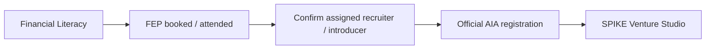

# Official AIA registration (Command Center)

Synthetic Command Center milestone. Official AIA iRecruit remains the system of record. No schema migration.

Entities stay distinct: `Candidate → User Account → Program Enrollment → Program Role`. AIA registration is an append-only **candidate timeline** event. It does not create a user account, program enrollment, or program role, and it does not change Versa/SPIKE entitlements or paid L2.

## Journey

AIA advisor path only (`program_interest = ra_spike`). Interns and free learners never enter this gate.

States (derived from `candidate_events`, not new `candidates.stage` values):

1. `aia.attribution.confirmed` — staff confirms recruiter/introducer + referral source
2. `aia_registration_pending` — candidate self-report or staff recording that report
3. `aia_registration_submitted` — human staff action
4. `aia_registration_verified` — human staff action (who verified + when)

Leader task after attribution: **Help candidate register via your AIA account / iRecruit**.

Do not auto-mark signup, acceptance, licensing, or agent coding. Do not advance `irecruit_started` / `licensing` / `coded` from this flow. A Versa lead or paid flag never implies AIA registration.

## Public link inventory (docs only)

These pages are **not** Command Center handoff URLs. Sending a candidate through them would drop recruiter attribution.

- https://www.aia.com.ph/en/financialadvisor/partner-with-the-best
- https://www.aia.com.ph/en/financialadvisor/join-us-now

No AIA credentials fields, no iRecruit form links, no scraping, no cloned AIA form, no invented deep links.
