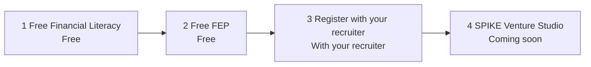

# Synthetic visitor journey (SPIKE × Versa preview)

Synthetic-only. No live applicants, no DB migration, no production deploy.

1. Open `/spike-preview` (staging Access still in front of the Worker). `/` stays 307 → `/gia`.
2. First viewport: one-line hero **Ask GIA. Start free.**, Ask GIA composer, **Find your path** (3 taps: goal, situation, time), the three invitations, and the AIA advisor 4-step journey. **About the AIA advisor career** is on this page (based on AIA Philippines public career information, sourced per section). Disclaimer, Privacy notice, and STOP stay on a sticky strip. **Nothing is stored. No account.**
3. Three taps route into GIA with a matching deterministic script and highlight the invitation (or the recruiter step). Nothing is stored. No account. No PII. Interns never land on AIA registration.
4. GIA stays alive: `msg-in`, skippable typing dots (off under `prefers-reduced-motion`), and follow-up chips after every answer including **How do I join AIA / register?** and the career KPs.
5. Consent card (approved copy): name, email, unticked checkbox, Save consent and contact. STOP / don’t send IDs or documents / privacy link stay visible. No DOB, address, or ID.
6. After consent, **Register with your recruiter** greets with “Your recruiter, \<name\>, will be with you on AIA's form” and a short note: “This opens AIA's official registration with your recruiter.” The copy-ready **Your details for AIA registration** card follows C1’s shared field order. Fields we already have get Copy; Honorifics, DOB, Applying To Be, and Preferred Location show “You'll fill this in on AIA's form”. Mobile shows format `639XXXXXXXXX` without collecting a number. No new PII on the landing. If no attributed URL is configured: **Your recruiter will contact you** (no link). URL prefill is not supported.
7. After consent, **Show FEP sessions** → **Book this FEP** writes the existing FEP booking; **Save leader request** writes the existing handoff. Command Center `/recruitment/command` shows the candidate event after staff sign-in (`/login` now lands on Command Center).
8. Assigned leader (admin assignment) sees only assigned records. **STOP / opt out** suppresses further contact.

AIA advisor path only (not intern or free-learner paths):

Visitor stepper note: “Step 3 is for the AIA advisor path. You'll register through AIA's official process with your own recruiter, so your mentor stays with you from day one.” Public AIA pages are labelled **(reference)** links only, never the Register CTA. Level-Up payment and AIA registration are separate checks.

Screenshots in this folder (390 and 1440): `landing-*`, `path-picker-*`, `journey-*`, `about-aia-*`, `gia-panel-*`, `gia-typing-*`, `aia-register-*`, `consent-card-*`, `copy-details-*`, `recruiter-cta-*`, `stop-*`, `gia-page-*`.
