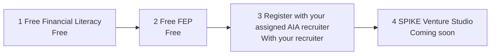

# Synthetic visitor journey (SPIKE × Versa preview)

Synthetic-only. No live applicants, no DB migration, no production deploy.

1. Open `/spike-preview` (staging Access still in front of the Worker). `/` stays 307 → `/gia`.
2. First viewport: one-line hero **Ask GIA. Start free.**, Ask GIA composer, **Find your path** (3 taps: goal, situation, time), the three invitations, and the AIA advisor 4-step journey. Disclaimer, Privacy notice, and STOP stay on a sticky strip.
3. Three taps route into GIA with a matching deterministic script and highlight the invitation (or the recruiter step). Nothing is stored. No account. No PII. Interns never land on AIA registration.
4. GIA stays alive: `msg-in`, skippable typing dots (off under `prefers-reduced-motion`), and follow-up chips after every answer including **How do I join AIA / register?**
5. Consent card (approved copy): name, email, unticked checkbox, Save consent and contact. STOP / don’t send IDs or documents / privacy link stay visible.
6. After consent, **Show FEP sessions** → **Book this FEP** writes the existing FEP booking; **Save leader request** writes the existing handoff. Command Center `/recruitment/command` shows the candidate event after staff sign-in (`/login` now lands on Command Center).
7. Assigned leader (admin assignment) sees only assigned records. **STOP / opt out** suppresses further contact.

AIA advisor path only (not intern or free-learner paths):

Step 3 never opens iRecruit or a generic AIA sign-up. AIA’s official process is the system of record. SPIKE does not submit or confirm AIA applications. Public AIA pages (link out only): [partner-with-the-best](https://www.aia.com.ph/en/financialadvisor/partner-with-the-best) and [join-us-now](https://www.aia.com.ph/en/financialadvisor/join-us-now). Level-Up payment and AIA registration are separate checks.

Screenshots in this folder (390 and 1440): `landing-*`, `path-picker-*`, `journey-*`, `gia-panel-*`, `gia-typing-*`, `aia-register-*`, `consent-card-*`, `stop-*`, `gia-page-*`.
