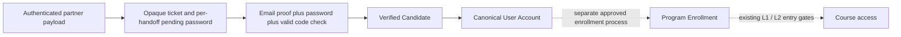

# Versa handoff and member onboarding — synthetic draft

Owner sources: [brief 6943631448](https://github.com/nmatunog/NEXO/issues/32#issuecomment-6943631448) and [superseding decisions 6944359204](https://github.com/nmatunog/NEXO/issues/32#issuecomment-6944359204), 17 November 2026. Rule 9 fixes: [owner-directed brief 6948767837](https://github.com/nmatunog/NEXO/issues/32#issuecomment-6948767837). #27 is rebased onto the #26 merge on `mvp01/staging-cf`, `f67ab99138f3a066d1d56da923c82959a2faaaf9`. #26 is not changed.

## Reuse and boundaries

UI reference: owner-provided `spike-auth-mockups.zip`, SHA-256
`132bc11f9e75e23b6a254158e902ce2231432b67c097fbec1216e98df3e543ca`.
The signup, signup-done and signin HTML/CSS are the visual reference; fixture identities
are replaced with fictional `example.test` identities. No-delivery copy follows the
superseding owner decision. A replacement email link also works in an already-open
verification tab; its fragment is consumed and immediately removed again.

- Auth.js credentials/JWT sessions remain the authentication shell. `member:<canonical account UUID>` is distinct from `staff:<email>`; existing server staff authorization continues requiring the latter plus the configured roster. Member JWTs are rejected after logout/password reset/change via a stored version check.
- Canonical `candidates` and `user_accounts` are reused **only after** email ownership and password sign-in succeed. Temporary pending signup hashes are not active accounts and cannot authenticate. No new CRM, program enrollment, program role, marketing consent or AIA registration is created. Existing verified candidate names/assignment/STOP/consent are preserved.
- SPIKE's portable code verifier is copied byte-for-byte from `nmatunog/SPIKE` at `482c31ced71096a9edc1d732af58bffcee4f0c6f`, `functions/_shared/versaCode/`, into `lib/vendor/versa-code/`. Its existing `verify()` is called without redemption, with the existing imported-plan, identity, status, expiry and level logic. `redeem()` is never called. A non-granting adapter prevents entitlement writes. No new verifier HTTP endpoint is invented. The verifier may record failed attempts/rate counters in its adapter; it is not side-effect-free. The current adapter is in memory. Only a `valid` available-code result confirms a handoff; free-entry/already-granted bypasses do not confirm a new handoff.
- The local demo uses the upstream in-memory admin fixture adapter with designated synthetic FREE/PRO inventory. Real authoritative inventory/service connection is an **open dependency**. Existing SPIKE L1/L2 entry checks/redemption remain in SPIKE and are untouched. The handoff claim neither consumes their code nor grants access/payment/eligibility.
- Separate SPIKE Internship / RA-SPIKE Supabase auth and learner IDs are not migrated or implicitly linked. An approved provider/identity mapping is required before real cross-portal account reuse. No separate production identity silo is enabled by this draft.

## Incoming contract

The browser contract is now **`GET /?handoff=<opaque signed ticket>`**.
A trusted server first calls `POST /api/member/handoff` with the six fields below
and extras as a flat JSON object. This is a new transport issuer, not a new code-verifier endpoint.

Authenticate the exact UTF-8 JSON body using `X-Versa-Timestamp` (Unix seconds),
`X-Versa-Nonce` (32 random bytes as lowercase hex), and `X-Versa-Signature`:

```text
HMAC-SHA256(issuer_secret, "versa-issuer-v1\n" + timestamp + "\n" + nonce + "\n" + body)
```

The issuer key is separate from the member-session key, at least 32 characters.
Timestamps have a two-minute acceptance window; a unique HMAC-stored nonce prevents
request replay. The ticket contains only random ID, expiry and a domain-separated
HMAC. Its server-side payload expires after five minutes; an atomic conditional
update permits exactly one arrival. Replay/refresh fails closed. No account/code
mutation happens on ticket issuance or GET arrival. Use HTTPS and approved machine
auth/Access configuration before any hosted integration. Hosted remains disabled.

| Lowercase key | Meaning | Bound |
| --- | --- | --- |
| `mfn`, `mln` | Member first/last name | each 1–80 code units |
| `me` | Member email and SPIKE username | valid email, ≤254, normalized lowercase |
| `sfn`, `sln` | Sponsor first/last name, not verified AIA recruiter attribution | each 1–80 |
| `code` | SPIKE access code, never AIA recruiter code/member ID | ≤64; configured `CodeFormat` adapter; synthetic FREE/PRO default |
| extra fields | Opaque variable data, retained server-side; no authority is inferred | ≤20, keys ≤40, values ≤512 |

Field names are case-sensitive. Duplicate keys/case variants, missing core values, controls/bidi overrides, malformed email/code, oversized input and reserved prototype/credential keys are rejected. The whole encoded query is capped at 8192 characters and 26 fields. Blank optional extra values are retained. React text/attribute escaping handles imported display values; no HTML insertion is used. Extra fields are never serialized into pages or reflected into subsequent URLs, roles, payment, recruiter attribution or course policy.

The root receiver consumes the ticket before an **application** redirect and sets
an opaque HttpOnly SameSite=Lax cookie for 15 minutes. HTTPS cookies are Secure.
Existing, pending and unknown account arrivals all use 303 `/signup`; GET does not
look up credentials or pending passwords. The page uses signed imported details,
not account state. Invalid tickets get the same clean recovery URL. Signup POSTs
return identical 200 bodies for all valid handoffs regardless of account existence;
existing credentials are never overwritten. Ordinary root visits preserve the #26 landing.

Plain `mfn/mln/me/sfn/sln/code` queries are rejected unless **both** local-demo mode
and `MEMBER_ALLOW_PLAIN_QUERY=true` are explicitly set. The latter defaults off,
including in the normal synthetic harness. Runtime also rejects any hosted origin
or non-loopback database. This fallback is not a partner or hosted contract.

`memberAdapters.codeFormat` is the configuration seam; `CodeFormat.normalize()` is
injected into parsing, with the current FREE/PRO pattern as synthetic default. It
is separate from `CodeVerifier.check()`, whose authoritative source is explicitly
pending. No guessed partner format, verifier URL or approval is asserted.

## Signup / verification / sign-in

1. `/signup` displays read-only name, email, sponsor and code using the approved auth mockup. Only password + confirm are entered; minimum 8 actual characters, maximum 256 code units. POST identity is read from the server session. Any attempted identity/authority field in a signup POST is rejected.
2. “Create my account” stages a salted scrypt hash in a 30-minute pending signup and prepares a 10-minute single-use email challenge. No canonical account/contact is linked or activated at this step. Pending passwords are keyed by handoff, not uniquely by email. Independent handoffs cannot reserve an email or overwrite each other; repeated POSTs on the same handoff are idempotent. Existing credentials are never overwritten.
3. `/signup-done` says “Check your email”. The mockup's delivery claim is deliberately replaced with **“No email was sent. Open the link in the local test mailbox, then sign in.”** This follows the owner's no-live-email decision.
4. The mail link carries only a random fragment token. Its page strips that fragment before the user confirms via POST. Email proof rotates the handoff cookie and invalidates the original one. Verification alone does not activate an account: the email holder must then sign in with the staged password in that proof-bearing browser. This prevents an attacker who pre-registered another email with a known password from signing in after the email holder clicks a link.
5. On the first valid proof + password sign-in, the real verifier is checked against synthetic imported inventory; canonical account creation, credential binding and local handoff claim commit in one transaction. Email/claim uniqueness and row/advisory locks prevent racing duplicates. No course entitlement is written. The original requester cannot reuse the pre-verification cookie. Existing members sign in and explicitly link only a matching, email-verified handoff; their passwords remain unchanged.
6. `/signin` is the subsequent entry. Forgot-password responses are generic. Reset links are random, 15-minute, single-use; reset and authenticated password change invalidate old sessions. Pending signup recovery is scoped to the proof-bound handoff, but still needs a valid handoff/code before activation. Logout invalidates member sessions and clears the handoff cookie.

Verification/reset challenges store HMAC digests. The local synthetic mail sink necessarily holds the synthetic link; it has no HTTP retrieval endpoint and is denied to public/GIA DB roles. Handshake and rate-window expiry is pruned on arrivals; pending intents expire after 30 minutes; local sink messages are pruned after one hour. Verification is not marketing consent. Sponsor names are stored separately as unverified data and never replace trusted AIA recruiter configuration.

## Run locally (no real email or hosted DB)

All commands use `SKIP_AUTO_SHIP=1 AUTO_SHIP=0`.

1. Install existing locked dependencies and build with `NEXT_FONT_GOOGLE_MOCKED_RESPONSES="$PWD/tests/gia/font-mock.cjs" npm run build:cf`.
2. `node tests/gia/member-demo-server.mjs` starts an ephemeral synthetic PGlite DB on loopback and the app at `http://127.0.0.1:3002`. This explicitly enables the local-only member adapters and generates temporary secrets. It never contacts Supabase, a real mailbox, a verifier endpoint, or a deployment service.
3. `node tests/gia/member-sample-link.mjs` signs a fictional body with the local
issuer secret from the ignored `work/member-issuer.json`, then prints a fresh usable
`http://127.0.0.1:3002/?handoff=...` link. The six fields/code never appear in that URL.
The generated link is single-use and lasts five minutes. Do not commit it or share
it as a deployed integration. FREE/PRO SYN00001 and SYN00006–40 are available local
inventory; 00002 expired, 00003 reused, 00004 revoked, 00005 wrong owner, 00099 unknown.

4. Read `member_local_mail` directly from the local DB for test links; there is deliberately no public mail/debug endpoint. Playwright does this only on `127.0.0.1:55432`.
5. `MEMBER_LOCAL_DEMO=true GIA_PILOT_ENABLED=true npx playwright test --timeout=90000` exercises the full browser suite. Unit tests inject an isolated PGlite store and the same pinned verifier.

## Open dependencies / release hold

- Real mail provider and approval: pluggable `MemberMailer.send` exists; only the local synthetic sink is supplied. No delivery to a real address is implemented or claimed.
- Reviewed authoritative verifier/storage adapter and identity mapping to existing program accounts. No guessed remote URL, CSV import to a live store, or real code is used.
- Physical member identity storage placement remains a reviewed architecture/deployment decision. `0012_member_onboarding.sql` is additive **draft schema**, applied only to ephemeral local test DBs. It grants no new access to `gia_app` or public roles. It now defines a dedicated NOLOGIN `member_app` role, FORCE RLS and server-only policies, minimal canonical columns and no program/entitlement writes. Local runtime queries bind the request email/account/candidate ids with transaction-local settings **before** `SET LOCAL ROLE member_app`; missing values are cleared, never inherited from the pool. Account SELECT is limited to the bound id; direct INSERT/UPDATE, DELETE and candidate reassignment are not granted. Fixed definer functions handle pending creation and activation, as specified in the LOW-1/LOW-2 section below. Candidate reads require the request's verified email. Neither setting a scope nor possessing the DB role is a public API; these are trusted server-only operations. Synthetic mailbox reading is isolated to a separate NOLOGIN test-reader role; member_app cannot read links. Hosted role membership/placement still needs deployment review; no grants or SQL were applied live.
- The runtime defaults off. Even when the feature flag is set, the supplied adapter requires explicit local-demo mode, loopback DB + HTTP origin, real-length non-placeholder server secrets and synthetic inputs. It fails closed on hosted configurations.
- GIA's separately reported 007/recruiter-name over-refusal remains a real-intake review dependency. This PR does not change credential safety or approved GIA answers.
- SPIKEDEV second-check → Claude independent exact-head Q1 → ChatGPT Rule 9 → Nilo's separate merge/deploy decision. No live email, DB, Access policy, merge or deployment is included.

## Identity mapping



Match only an email-verified Candidate after proof, never sponsor name/code. Create
a Candidate only when none matches. Member signup inserts into the same canonical
`user_accounts` table with `ON CONFLICT(candidate_id) DO NOTHING`, not the shared
provisioner's no-op UPDATE. That helper and its other callers remain unchanged.
Only a newly inserted pending account can activate; an existing account, including
a disabled one, is never reactivated by signup. A concurrently created candidate
causes a clean retry rather than widening the current transaction scope. Existing
canonical accounts without a reviewed auth mapping are not silently reset or linked.
`member_credentials.account_id` and claims reference the canonical User Account.
There is no automatic Program Enrollment, program role, entitlement, payment or AIA
registration. Cross-program Supabase account mapping remains an external contract.

## Cloudflare Access and logs — no policy changes

Access executes **before** the Worker. App code cannot consume any request before
an Access redirect. Switching to signed opaque tickets removes member/sponsor/code
values from browser URLs and therefore from an Access redirect of the supported
contract; the server-to-server POST carries those fields only in its bounded body.
No application log includes request bodies, signatures, tickets, passwords or emails;
Next request logging is disabled and errors are generic. Every member response is
no-store/no-referrer, and application redirects contain neither ticket nor payload.

**Remaining infrastructure gate:** Access/browser/history/proxy logs may still hold
the short-lived bearer ticket. App headers cannot redact upstream logs. An obsolete
plain query sent to a protected host could still leak its values before rejection.
Do not send one. Before any hosted traffic, require the partner to use this POST +
opaque-ticket contract, review/redact full URLs and auth headers in infrastructure,
and approve the exact Access service-auth/receiver policy and tester login flow.
This cannot be fixed or verified by changing Worker code behind Access. Hosted
runtime stays closed; no claim that upstream logging/policies are resolved.

Scope tester identities to root/landing, `/signup`, `/signup-done`, `/signin`, member
pages/APIs, required Auth.js endpoints and static assets/GIA as separately approved.
Do not use a host-wide bypass. Preserve owner/staff-only protection on Command
Center and `/api/recruitment/*` / `/api/admin/*`; test policy precedence. No policy
was written and no live partner URL is released by this PR.

## Historical M1 correction at 4b70c49 (superseded by LOW-1/LOW-2 below)

Source: [SPIKEDEV brief 6953819929](https://github.com/nmatunog/NEXO/issues/32#issuecomment-6953819929)
and Claude Q1 BLOCKED at `5b23ff0`. The former account policy allowed an unscoped
SELECT, active INSERT and disabled→active UPDATE. It is replaced with separate
command policies. Only `id`, `candidate_id` (needed by the conflict arbiter) and
`status` are readable; only `status` is updatable. The UPDATE requires a pending
source row, an active result and matching request ids/current verified candidate.
Session/status reads bind an account id derived from the credential or JWT;
password resets bind the immutable challenge account id before locking/rechecking
the single-use challenge. Linking locks credentials, not active account rows,
because the role has no UPDATE authority over active accounts.

`lib/member/account-rls.test.ts` applies all migrations to PGlite and runs each
probe in its own transaction as `member_app`, with request scope bound first and
FORCE RLS enabled. It covers disabled reactivation, cross-account reads/updates,
active insertion, DELETE, reassignment, candidate email scope, pool-scope clearing
and a successful own-row pending→active transition. The ordinary member service
and browser suites also exercise complete signup/sign-in/reset/link lifecycles.
No handoff, ticket, approved wording or verifier logic is changed by this correction.

## LOW-1 / LOW-2 hosted holds and fixed database capabilities

The member connection for hosted use **must** be a dedicated LOGIN-enabled,
non-owner, NOSUPERUSER, non-BYPASSRLS login whose only role membership/privileges
come from `member_app`. It must not own tables or functions, inherit an owner/staff
role, have CREATE/CREATEROLE privileges, or share the existing owner/GIA login.
Then RESET ROLE returns only to that restricted login and gains no owner rights.
This is a hosted wiring requirement, not a deployed change: no hosted login/role,
password, membership or database was created or modified by this draft.

`member_app` has no direct INSERT or UPDATE privilege on `user_accounts`. The only
account writes are migration-owner SECURITY DEFINER functions with fixed
`search_path = pg_catalog, public`, explicit `public` table references and no dynamic
SQL. `member_create_pending_account(uuid,uuid,text)` checks the bound arguments and
verified candidate/email relationship and inserts pending only; conflicts return
null. `member_activate_account(uuid,uuid)` matches both ids and changes pending to
active only, returning false for a disabled/active/mismatched row. PUBLIC execute is
revoked; only `member_app` is granted execute. The migration owner must retain the
authorized rights needed for these fixed operations; the connecting login must not
be that owner. No broad account write policy remains.

Credentials now have per-command email/account scope policies. Challenges likewise
use account/pending-email scope; verification rows carry their pending email.
Scope-free verification/reset-token discovery uses only the private fixed-path
`member_lookup_challenge(hash,kind)` function. It accepts one exact 64-hex token hash
and kind, returns at most one row and locks it in the calling transaction. The
service still revalidates expiry and consumption under that lock, preserving single
use. Every credential reader/writer and challenge mutation establishes its scope.

These capabilities are not an arbitrary-SQL sandbox: custom settings remain mutable
and a scoped read filter is defense-in-depth. The fixed functions enforce their
argument/state invariants, but do not independently prove email ownership, partner
authenticity or code eligibility; the unchanged parameterised service flow supplies
those checks. Do not expose the DB login/functions as public RPCs. Hosted Access,
mail-provider, authoritative-verifier and identity-placement holds still apply.
The RESET ROLE regression creates only an ephemeral local PGlite login fixture.

The current local synthetic harness still bootstraps using its local owner login;
the restricted-login RESET ROLE probe is a separate ephemeral fixture. This draft
does not claim that the local owner connection itself prevents RESET ROLE.
